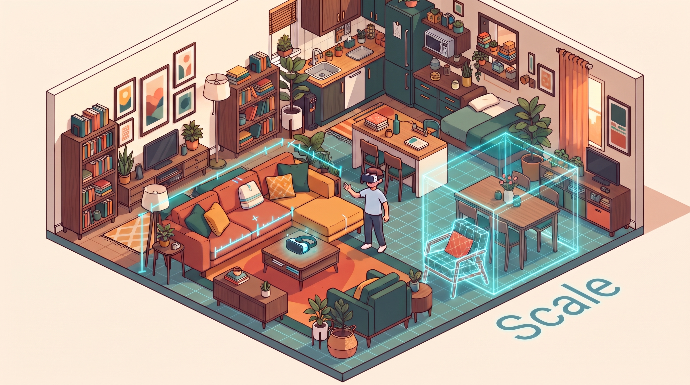
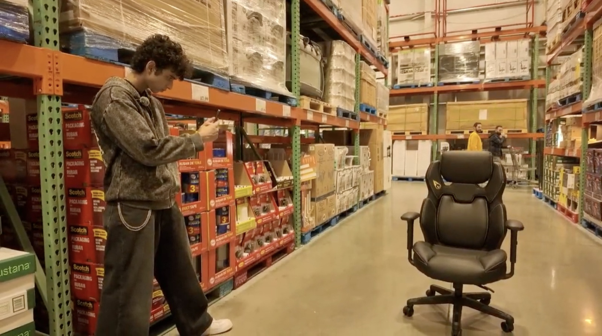
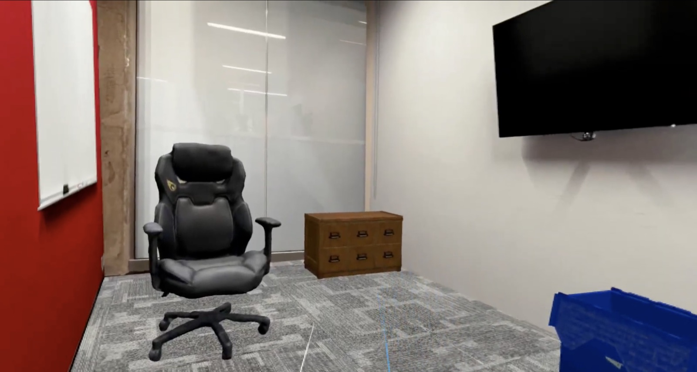
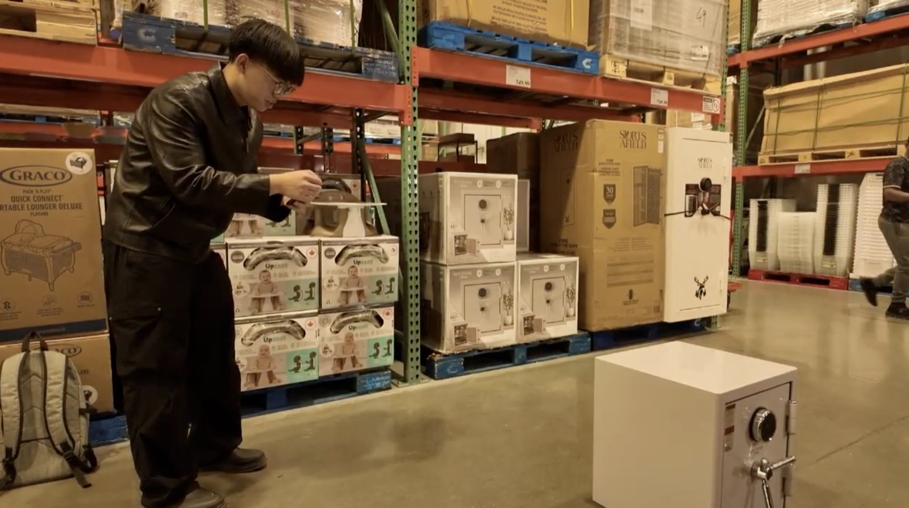
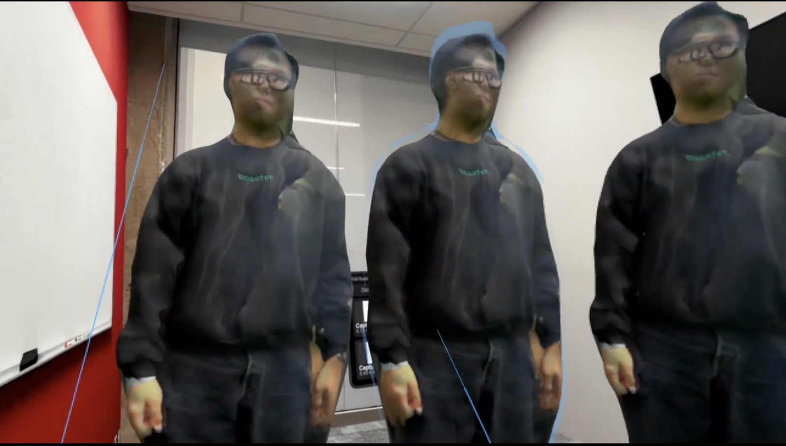
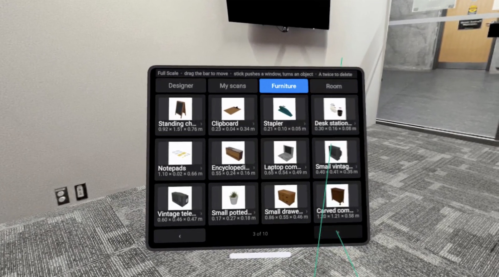
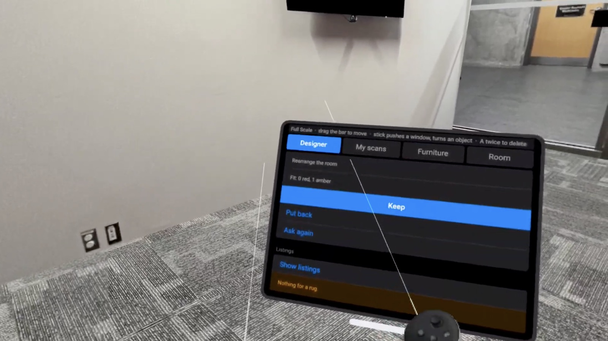
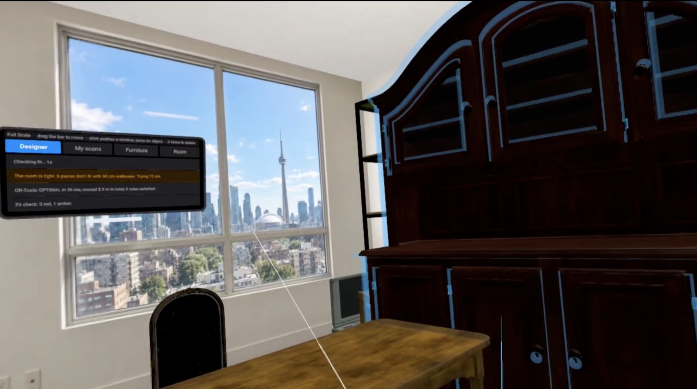
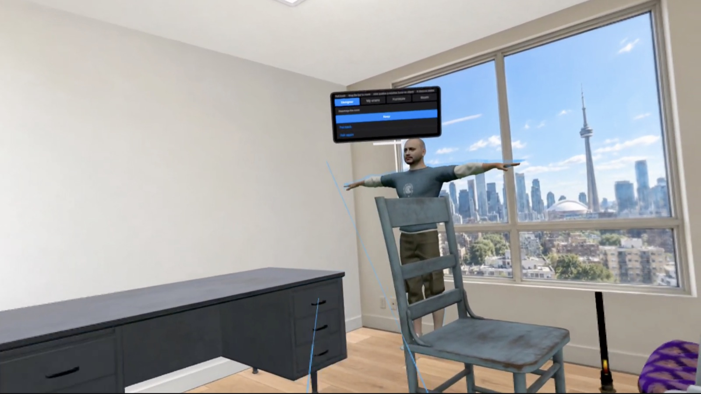
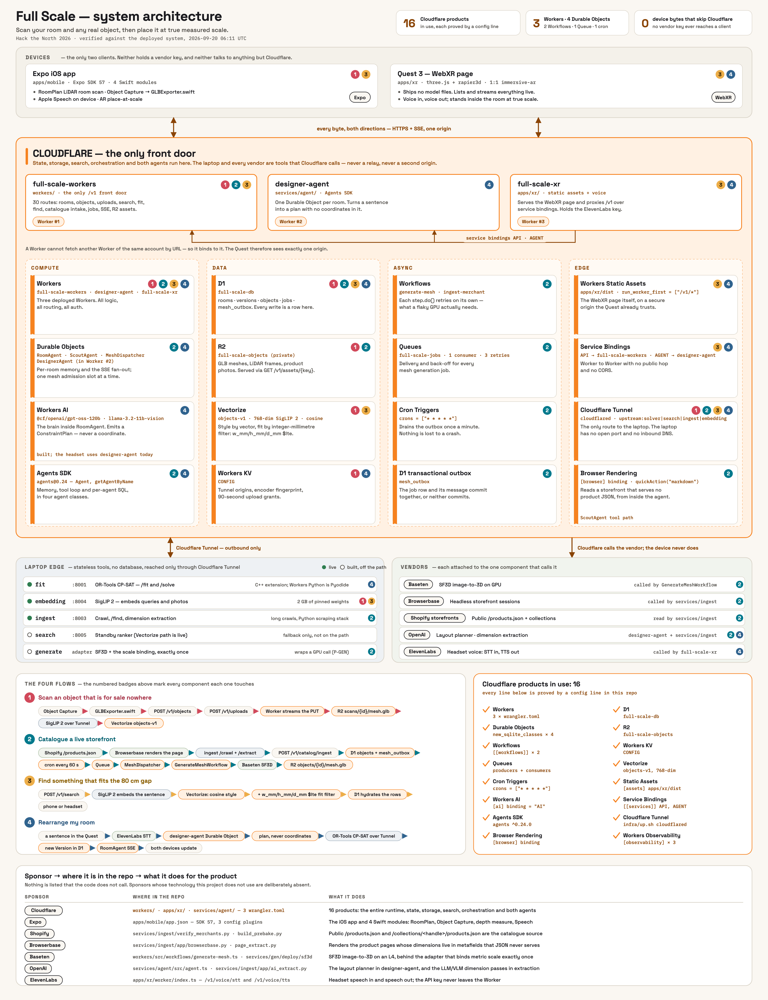

https://github.com/user-attachments/assets/6ad0c49c-1cf5-4c4a-b9af-98400d4c6c59

<p align="center">
  
</p>

<h1 align="center">Scale</h1>

<p align="center"><strong>Scan any object. Find what fits. Stand inside the result at 1:1.</strong></p>

<p align="center">
  Point your phone at a chair in a warehouse, a safe on a shelf, or a friend in the hallway.
  Scale measures it with LiDAR, reconstructs it in 3D, finds real products like it that actually fit your room,
  and drops everything into a Meta Quest at true scale.
</p>

## See it

<table>
  <tr>
    <td width="50%"></td>
    <td width="50%"></td>
  </tr>
  <tr>
    <td><em>Scan a chair on the store floor with the phone.</em></td>
    <td><em>Minutes later it is standing in the office at full size, next to catalog furniture.</em></td>
  </tr>
  <tr>
    <td></td>
    <td></td>
  </tr>
  <tr>
    <td><em>Anything with a surface works, not just furniture.</em></td>
    <td><em>A teammate scanned on the phone, placed three times in the headset.</em></td>
  </tr>
  <tr>
    <td></td>
    <td></td>
  </tr>
  <tr>
    <td><em>A floating catalog you can grab and move. Every item carries real dimensions in metres.</em></td>
    <td><em>Ask the room to change. Review the fit result, then keep it or put it back.</em></td>
  </tr>
  <tr>
    <td></td>
    <td></td>
  </tr>
  <tr>
    <td><em>"The room is tight." The solver relaxes walkways from 90 cm to 75 cm and returns an optimal layout in 36 ms.</em></td>
    <td><em>The rearranged apartment, with a human avatar so the scale is unmistakable.</em></td>
  </tr>
</table>

---

## Why

Spatial shopping tools start with a catalog. Scale starts with the physical world.

The chair at the café, the desk on Marketplace, the product with photos but no 3D asset: all of it should be usable spatially. So we built one system around a single question:

> **"Find me something like this that actually fits here."**

Answering it means perception, retrieval, geometry, optimization, XR and commerce all have to agree about the same physical object.

## How it works

```text
room + object  →  RoomPlan / LiDAR  →  image or text query  →  SigLIP2 retrieval + Shopify
→  verified dimensions  →  deterministic fit check  →  2D→3D if no mesh exists
→  metric GLB binding  →  1:1 placement in Quest  →  exact variant and checkout
```

1. **Capture reality.** Apple RoomPlan rebuilds the room in metres. A custom LiDAR raycast-and-grow path measures single objects: width, height, depth, position, rotation. Object Capture produces a textured mesh for things you already own. Nothing here is guessed by a language model.
2. **Search by meaning.** Text and product images share one 768-d SigLIP2 embedding space. Similarity answers *what looks right*. The room answers *what is physically possible*.
3. **Search real products.** Shopify Global Catalog returns the merchant, the exact variant, price, availability and checkout URL. A product only gets a verified fit when its dimensions have trustworthy provenance. Otherwise it is marked **SIZE UNVERIFIED**.
4. **Reconstruct missing 3D.** One product image goes through Stable Fast 3D on Baseten. The generator supplies shape. The measurement supplies size. The binding step scales the mesh exactly once, moves the origin to bottom-centre, re-exports, reloads its own output and verifies the bounding box.
5. **Stand inside it.** Captured, generated and catalog objects share one metre-based coordinate system. On the Quest you walk the room at 1:1, grab furniture, rotate it, lift it with two hands.
6. **Ask the room to change.** "Turn this bedroom into a six-person workspace." The LLM turns intent into an objective and constraints. OR-Tools CP-SAT places the furniture. **The LLM never emits a coordinate.**

## Numbers

| | |
| --- | --- |
| **0.8 cm too wide / 4.3 cm clearance** | A real Shopify side table that missed a 50 cm gap, and the sibling variant that fit, with its live checkout link intact |
| **1.19 s** | Warm 1024-texture image-to-3D request on Baseten (28.71 s on the cold first request) |
| **36 ms** | OR-Tools optimal layout for a tight five-piece apartment |
| **262 products** | Dimensions recovered from rendered merchant pages that the product API did not expose |
| **100 products** | Curated spatial catalog across five furniture categories |
| **< 3 × 10⁻⁸ m** | Bounding-box error of the bound GLB against its target dimensions |

## Architecture

<p align="center">
  
</p>

Cloudflare is the control plane between the iPhone, the Quest, persistent room state, search and generation.

| Piece | Runs on | Role |
| --- | --- | --- |
| `apps/mobile` | iPhone, Expo + 4 Swift modules | RoomPlan, LiDAR measurement, Object Capture, USDZ→glTF, AR preview, room handoff |
| `apps/xr` | Meta Quest, WebXR + three.js + Rapier | 1:1 room, physics, grab/carry/rotate, floating panels, voice, live SSE updates |
| `workers` | Cloudflare Worker | Every HTTP route; D1, R2, KV, Vectorize, Queues, Workflows, Durable Objects |
| `services/agent` | Cloudflare Worker | Intent → objective and constraints |
| `services/fit` | Docker | Fit validation and OR-Tools CP-SAT arrangement |
| `services/gen` | Docker + Baseten | SigLIP2 embeddings, SF3D, metric binding and validation |
| `services/ingest` | Docker | Merchant crawl, Browserbase renders, dimension extraction and validation |
| `services/search` | Docker | Retrieval and ranking |

Shared schemas and routes live in [`.claude/contracts.md`](.claude/contracts.md). The deployed state is in [`docs/SYSTEM_STATE.md`](docs/SYSTEM_STATE.md). The full design reasoning is in [`BUILD_DOC.md`](BUILD_DOC.md).

## Built with

Apple RoomPlan, ARKit/LiDAR, Object Capture, Swift, Expo · SigLIP2, Cloudflare Vectorize · Shopify Global Catalog, Browserbase · Stable Fast 3D on Baseten · OR-Tools CP-SAT · Cloudflare Workers, D1, R2, KV, Queues, Workflows, Durable Objects · three.js, WebXR, Rapier · ElevenLabs · FastAPI, Docker

## Run it

<details>
<summary>Prerequisites and commands</summary>

Xcode 26+, a LiDAR iPhone (12 Pro or newer), a Meta Quest in developer mode, Node, Docker Desktop, `cloudflared`.

```bash
# iPhone
cd apps/mobile && npm install && npx expo run:ios --device

# Quest (ADB reverse + Vite on http://localhost:5173, open it in the Quest browser)
cd apps/xr && npm install && npm run quest

# Edge + services
cp infra/.env.example infra/.env   # fill in the upstream token
bash infra/up.sh
cd services/agent && npm run dev
```

Every `/v1` route returns a committed fixture when the request carries `X-Stub: 1`, so each client can be developed without the full live stack.

</details>
